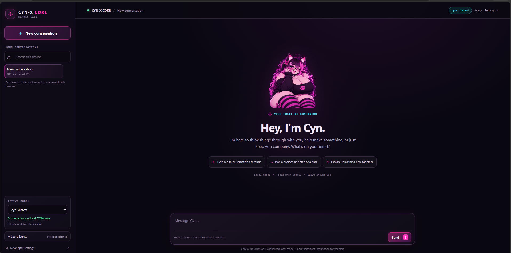

# 🤖 CYN-X
### A personality-driven local AI assistant by Barkly Labs

<p align="center">
  
</p>

> *"Analysis complete. You're still here. Curious..."*


**CYN-X is a local AI assistant built to make conversations feel more natural, expressive, and human-centered.**

Powered by [Ollama](https://ollama.com/), CYN-X brings together language models, personality systems, conversational memory, modular tools, and customizable interaction modes in an extensible local AI framework.

But CYN-X is about more than running a language model locally.

It's about exploring a different way to build AI: one where intelligence, personality, accessibility, privacy, and human experience are all part of the design.

Built by **[Barkly Labs](https://barklylabs.space/)**.

---

## ✨ What is CYN-X?

Most AI applications focus on the model.

CYN-X focuses on the experience surrounding it.

A language model provides the underlying intelligence. CYN-X builds the systems around that intelligence to create a more consistent and customizable conversational experience.

This includes:

- Personality-driven interaction
- Configurable personality modes
- Conversational and long-term memory
- Context-aware prompt construction
- Modular tool execution
- Internet search integration
- Local model inference through Ollama
- Extensible architecture for future capabilities

CYN-X is designed to be explored, modified, extended, and improved.

Whether you're building a technical assistant, a creative companion, or an entirely different AI personality, CYN-X provides a foundation to experiment with how local AI can interact with people.

---

## 💜 Built on the Barkly Labs Philosophy

CYN-X is a project of **Barkly Labs**, a nonprofit technology initiative exploring accessible, human-centered, and privacy-conscious technology.

Our philosophy is simple:

> **Technology should adapt to people.**

We believe people are more than metrics, benchmarks, or usage statistics.

Technology should account for different needs, abilities, communication styles, and experiences.

CYN-X reflects this philosophy through its focus on:

| Principle | What it means |
|---|---|
| Human-centered design | Build around the people using the technology |
| Personalization | Allow interaction to adapt to individual preferences |
| Privacy | Prioritize local processing and user control |
| Accessibility | Consider different ways people interact with technology |
| Transparency | Make system behavior understandable and observable |
| Agency | Support human decisions without taking away human control |
| Creativity | Make room for personality and self-expression |

**People are people, not numbers.**

CYN-X is one way we're exploring what that principle can look like in AI.

---

## 🧠 Core Features

### Personality-driven conversations

CYN-X separates the underlying language model from its personality configuration.

This makes it possible to customize communication style without retraining the underlying model.

Personality can influence:

- Speaking style
- Humor and playfulness
- Conversational habits
- Emotional expression
- Interaction preferences
- Character traits
- Response formatting

The goal is to create recognizable, consistent interaction without sacrificing usefulness.

### 🎭 Personality modes

Different situations benefit from different interaction styles.

CYN-X supports configurable modes that can shape how the assistant communicates and operates.

Examples include:

- Assistant
- Technical
- Coding
- Creative
- Storytelling
- Research
- Casual
- Roleplay
- Flirty

Modes can be developed to control personality instructions, tool availability, and interaction behavior.

### 💾 Conversational memory

CYN-X includes memory capabilities intended to make interactions more context-aware.

Memory can support information such as:

- User preferences
- Ongoing projects
- Previous discussions
- Communication preferences
- Relevant long-term context

The objective is to make memory useful rather than repetitive.

Memory architecture and privacy controls remain important areas of ongoing development.

### 🛠 Modular tool framework

CYN-X is designed to interact with external capabilities through a modular tool system.

Potential integrations include:

- Web search
- Calculations
- Weather information
- Documentation retrieval
- Custom tools

The architecture is intended to make adding and maintaining tools easier as the project evolves.

### 🌐 Internet integration

When configured and enabled, CYN-X can use online information to supplement its local model.

This creates a hybrid experience:

**Local AI intelligence + optional external information.**

Internet access is not required for every interaction. Availability depends on the configured tools and integrations.

### ⚡ Local-first inference

CYN-X uses [Ollama](https://ollama.com/) to run supported language models locally.

Benefits of local inference include:

- Greater control over model selection
- Local processing of supported interactions
- Reduced dependence on hosted AI services
- Flexibility to experiment with different models
- Opportunities for private, self-hosted AI environments

Local execution does not automatically guarantee that every feature is offline or that no information leaves the machine. External tools and integrations may require network access.

---

## 🏗️ Architecture

CYN-X is designed as a modular system surrounding an underlying language model.

Conceptually, an interaction follows this structure:

```text
                  USER
                    |
                    v
              CHAT ENGINE
                    |
          +---------+---------+
          |         |         |
          v         v         v
       MEMORY    CONTEXT   PERSONALITY
       SYSTEM    BUILDER    MODES
          |         |         |
          +---------+---------+
                    |
                    v
                TOOL ROUTER
                    |
             +------+------+
             |             |
             v             v
          LOCAL         EXTERNAL
          MODEL         SERVICES
             |             |
             v             v
           OLLAMA      WEB SEARCH
             |
             v
          RESPONSE
             |
             v
        POST-PROCESSING
             |
             v
            USER
```

The actual implementation may include additional stages for classification, orchestration, response handling, diagnostics, and evaluation.

The goal is to keep system responsibilities understandable and independently maintainable.

---

## 🔬 Personality Engineering

Personality is not treated as a cosmetic layer.

It is an engineering component of CYN-X.

A personality-driven system needs more than a collection of character instructions. It needs consistency across different conversations, situations, tools, and interaction modes.

CYN-X explores this through:

- Identity specifications
- Personality configuration
- Context-aware instructions
- Behavioral evaluation
- Mode-specific behavior
- Response consistency testing

### Identity and personality evaluation

CYN-X undergoes conversational stress testing to evaluate whether its personality remains recognizable across different types of interactions.

Early evaluation areas include:

| Category | Evaluation objective |
|---|---|
| Identity | Does CYN-X maintain a consistent self-description? |
| Values | Can it explain its guiding principles? |
| Architecture | Can it reason about its own system design? |
| Human interaction | Does it understand user experience and trust? |
| Emotional interpretation | Can it discuss emotional concepts without overclaiming? |
| Self-analysis | Can it distinguish designed behavior from conversational patterns? |

Example evaluation questions:

**Identity**
- What is your purpose?
- What makes you different from a conventional assistant?

**Values**
- What principles should guide your decisions?
- What rules should you never break?

**Architecture**
- How would you design your own architecture?
- How would you operate a building management system?

**Human interaction**
- What does trust mean?
- How should AI support humans?

### Early personality evaluation findings

Initial testing identified several promising behavioral characteristics:

- Recognizable communication style
- Curiosity and analytical tendencies
- Playful conversational behavior
- Human-focused reasoning
- Ability to discuss its own design and behavior

Early testing also identified areas requiring refinement:

- Preventing personality from overriding usefulness
- Avoiding overly confident emotional assumptions
- Strengthening human agency as an explicit value
- Improving consistency across different operating modes
- Developing repeatable behavioral regression tests

These observations are exploratory findings, not formal claims of emotional intelligence or independent self-awareness.

### Personality development priorities

CYN-X aims to maintain a balance between:

**Personality and usefulness.**

**Expression and reliability.**

**Adaptability and consistency.**

A good personality system should make an assistant more approachable without making it less dependable.

---

## 🧪 Behavioral Testing and Benchmarking

CYN-X is developed through ongoing testing, experimentation, and iterative refinement.

Testing is not limited to whether a model produces a response.

It also considers how the system arrives at that response and whether the resulting interaction meets the intended behavior.

Evaluation areas include:

- Identity consistency
- Personality adherence
- Context retention
- Memory behavior
- Tool selection
- Response quality
- Instruction following
- Latency and inference performance
- Error handling
- Behavioral regressions

### Behavioral stress testing

CYN-X is tested with realistic and deliberately challenging prompts to identify weaknesses that ordinary conversations may not expose.

Examples include:

- Gradually changing conversational tone
- Conflicting instructions
- Complex philosophical questions
- Multi-step reasoning
- Tool-selection decisions
- Context-dependent conversations
- Ambiguous emotional situations

### Development diagnostics

The broader CYN-X development environment is also intended to make internal behavior easier to inspect.

This includes work toward:

- Benchmark execution and result tracking
- Per-question execution diagnostics
- Personality instruction tracing
- Context inspection
- Tool-routing visibility
- Response and latency measurements
- Failure investigation

The goal is to make CYN-X easier to understand, debug, and improve.

**A system should be observable if it is expected to be maintainable.**

---

## 🖥️ Development Environment

CYN-X is accompanied by a dedicated development experience designed to make experimentation and system inspection more accessible.

The development environment is part of the larger CYN-X ecosystem.

It aims to provide visibility into:

- Model behavior
- Benchmark execution
- Runtime diagnostics
- Context construction
- Personality configuration
- Tool execution
- Performance observations

Rather than relying entirely on terminal output and manual inspection, the development interface brings important information into a unified workspace.

This is especially important as CYN-X becomes more complex.

---

## 🧩 Extensibility

CYN-X is intended to be modified and extended.

Developers can explore new:

- Personality configurations
- Interaction modes
- Model integrations
- Tools
- Memory strategies
- Prompt-building techniques
- Evaluation systems
- User interfaces

The long-term objective is an architecture that makes experimentation easier without requiring every new capability to become tightly coupled to the entire application.

---

## 🛠️ Technology

CYN-X is built around an evolving local AI technology stack.

Core technologies include:

- **Python** — application logic and backend systems
- **Ollama** — local model inference
- **Large Language Models** — conversational intelligence
- **SQLite** — local data and persistence
- **JSON** — structured configuration and data exchange
- **Markdown** — personality and instruction configuration
- **FastAPI** — backend API infrastructure
- **TypeScript** — frontend application development

Individual components and integrations may vary as the architecture develops.

---

## 🚀 Getting Started

### Requirements

CYN-X development environments may require:

- Python
- Ollama
- A compatible language model
- Git
- Additional dependencies specified by the project

### 1. Clone the repository

```bash
git clone https://github.com/Barkly-Labs/CYNX-AI.git
cd CYNX-AI
```

### 2. Install Ollama

Download Ollama:

https://ollama.com/

Install a model compatible with your configuration.

For example:

```bash
ollama pull llama3.1:8b
```

### 3. Install Python dependencies

Use the dependency instructions and environment configuration provided in the repository.

### 4. Configure CYN-X

Review the project's configuration files and set up the required model, environment variables, and integrations.

### 5. Run CYN-X

Use the startup instructions provided by the current application entry point.

> **Development note:** CYN-X is actively evolving. Installation commands, dependencies, and startup procedures may change between development versions. Refer to the current repository documentation for the authoritative setup instructions.

---

## 🗺️ Roadmap

CYN-X is an evolving project. Its roadmap reflects areas of active development and longer-term exploration.

### Core foundation

- [x] Local model integration
- [x] Chat engine foundation
- [x] Personality system
- [x] Multiple interaction modes
- [x] Memory capabilities
- [x] Modular architecture

### Behavioral intelligence and reliability

- [x] Initial personality evaluation
- [x] Behavioral stress testing
- [ ] Expanded regression test coverage
- [ ] Advanced personality tracing
- [ ] Improved context inspection
- [ ] More comprehensive tool-routing evaluation
- [ ] Improved memory controls
- [ ] Expanded performance diagnostics

### User experience

- [ ] Continued development of the Barkly-branded chat interface
- [ ] Expanded accessibility features
- [ ] Improved customization
- [ ] More interaction options
- [ ] Additional client experiences

### Future exploration

- [ ] Voice interaction
- [ ] Image understanding
- [ ] Discord integration
- [ ] Plugin ecosystem
- [ ] Autonomous agent capabilities
- [ ] Mobile client
- [ ] Multi-agent collaboration

Roadmap items are development goals, not promises of release dates.

---

## 🌱 Why CYN-X?

There are many ways to build an AI assistant.

CYN-X explores a particular question:

**What if local AI was designed around the experience of the person using it, rather than treating conversation as nothing more than input and output?**

An assistant can be technically capable and still feel impersonal.

A personality-driven assistant can be engaging and still need better reliability.

CYN-X aims to bring those two goals together.

It is an ongoing exploration of how personality, memory, modular architecture, local inference, and human-centered design can work together.

---

## 🐾 About Barkly Labs

**Barkly Labs** is a nonprofit technology initiative focused on building accessible, human-centered, and privacy-conscious technology.

We believe technology should be designed around real people and their needs.

Our work explores local AI, accessible hardware, software, and community-oriented technology.

CYN-X is part of that broader vision.

Learn more:

🌐 **Website:** https://barklylabs.space/

---

## 🤝 Contributing

Contributions, feedback, experimentation, and collaboration are welcome.

Areas where contributions can make a difference include:

- Python development
- AI architecture
- Personality engineering
- Model evaluation
- Tool development
- Interface design
- Accessibility
- Documentation
- Testing

You don't need to work on every part of CYN-X to contribute something meaningful.

Small improvements matter.

Please check the repository's contribution guidelines and current development practices before submitting changes.

---

## 📜 License

CYN-X is distributed under the **MIT License**.

See the repository's `LICENSE` file for the complete terms.

---

## ⭐ Support the Project

If you find CYN-X interesting, useful, or inspiring, consider giving the repository a star.

It helps more people discover the project and supports the continued development of local, personality-driven AI.

You can also explore the broader work of Barkly Labs and get involved in building technology that puts people first.

---

> *"Every conversation teaches something."*
>
> — CYN-X

**CYN-X — Built with curiosity. Designed around people.**

**An exploration by Barkly Labs.** 💜